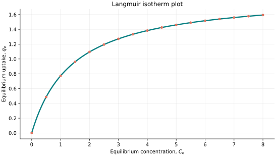
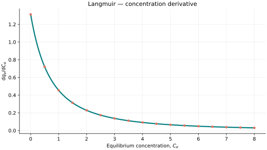
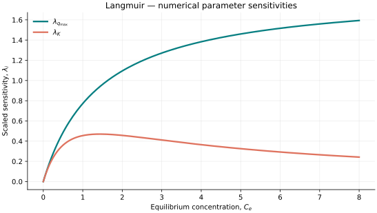

..
   ==============================================================================
   Name        : Langmuir.rst
   Authors     : Joao Flavio Vasconcellos
   Version     : 2.0.0
   Description : Langmuir scientific documentation and numerical parameter sensitivities.

   Copyright   : Copyright (C) 2026 Joao Flavio Vasconcellos
   Licence     : MIT License (see LICENSE)
   SPDX-License-Identifier: MIT
   ==============================================================================

Langmuir isotherm
=================

Original publication and scope
------------------------------

Langmuir, I. (1918), *The Adsorption of Gases on Plane Surfaces of Glass,
Mica and Platinum*, *Journal of the American Chemical Society*, **40** (9),
1361–1403. `DOI: 10.1021/ja02242a004 <https://doi.org/10.1021/ja02242a004>`_.
This is the primary source for the classical adsorption model.

The development was preceded by Langmuir, I. (1916), *The Constitution and
Fundamental Properties of Solids and Liquids. Part I. Solids*, *Journal of
the American Chemical Society*, **38** (11), 2221–2295.
`DOI: 10.1021/ja02268a002 <https://doi.org/10.1021/ja02268a002>`_, and
Langmuir, I. (1917), *The Constitution and Fundamental Properties of Solids
and Liquids. II. Liquids*, *Journal of the American Chemical Society*,
**39** (9), 1848–1906.
`DOI: 10.1021/ja02254a006 <https://doi.org/10.1021/ja02254a006>`_.

The model assumes adsorption on a fixed number of energetically equivalent
sites, with one adsorbate molecule per site, a monolayer at saturation and
no lateral interactions between adsorbed molecules. Adsorption and desorption
are in dynamic equilibrium. In the original gas-adsorption setting, the
fractional surface coverage can be expressed as
:math:`\theta=KP/(1+KP)`, where :math:`P` is gas pressure. The concentration
form implemented here uses :math:`C_e` instead of pressure, with :math:`KC_e`
required to be dimensionless. The saturation capacity is :math:`q_{\max}`.

Mathematical formulation
------------------------

.. math::

   q_e=\frac{q_{\max}KC_e}{1+KC_e}.

The admissible parameter and input domain is

.. math::

   q_{\max}>0,\quad K>0,\quad C_e\geq0.

Here :math:`C_e` denotes equilibrium concentration.

The adjustable parameters are :math:`q_{\max}`, :math:`K`.

C++20 usage
-----------

.. code-block:: cpp

   #include <isotherm/isotherm.hpp>

   const isotherm::models::Langmuir model{1.87902, 0.698076};
   const isotherm::Real uptake = isotherm::evaluate(model, 0.5);
   const isotherm::Real slope = isotherm::derivative(model, 0.5);

.. raw:: html

   

     <a class="isotherm-source-action" href="../../../source-browser/include/isotherm/models/TwoParameters/Langmuir.hpp.html">Implementation</a>
     <a class="isotherm-source-action" href="../../../source-browser/IsothermTest/TwoParameters/Langmuir/test_langmuir.cpp.html">Tests</a>
     <a class="isotherm-source-action" href="../../../source-browser/Examples/TwoParameters/Langmuir/main.cpp.html">Example</a>
   

Langmuir isotherm plot
----------------------

   Equilibrium uptake evaluated through the C++ model interface.

Concentration derivative
------------------------

   Derivative evaluated through the C++ model interface.

Numerical sensitivity
---------------------

For each parameter :math:`k_i`, the scaled parameter sensitivity is

.. math::

   \lambda_i(x)=k_i\frac{\partial q_e(x)}{\partial k_i}.

Numerical values are obtained by perturbing individual parameters and evaluating new instances of the C++ model. The accompanying C++20 example performs this procedure.

   Numerical scaled sensitivities versus equilibrium concentration.

Validation and limitations
--------------------------

.. math::

   q_{\max}>0,\quad K>0,\quad C_e\geq0.

