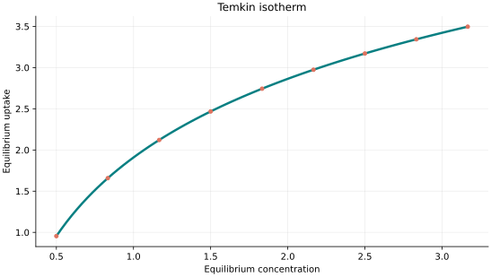
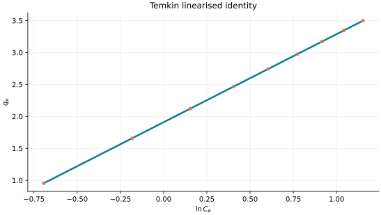
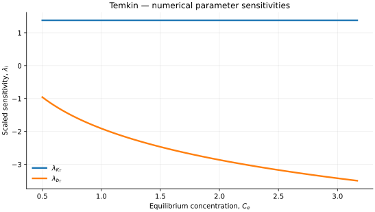

..
   ==============================================================================
   Name        : Temkin.rst
   Authors     : Joao Flavio Vasconcellos
   Version     : 2.0.0
   Description : Temkin scientific model, domains, plots and C++20 usage.
   
   Copyright   : Copyright (C) 2026 Joao Flavio Vasconcellos
   Licence     : MIT License (see LICENSE.txt)
   SPDX-License-Identifier: MIT
   ==============================================================================

Temkin isotherm
===============

Original publication and scope
------------------------------

The Temkin isotherm is associated with the treatment of adsorption on
energetically non-uniform surfaces and interactions between adsorbed
molecules. The frequently cited Temkin--Pyzhev paper (1940) examines
ammonia-synthesis kinetics, whereas Temkin (1941) directly addresses
adsorption equilibrium. The two publications should not be treated as
interchangeable sources for a particular isotherm equation.

Temkin, M. I., and Pyzhev, V. (1940), *Kinetics of ammonia synthesis on
promoted iron catalysts*, *Acta Physicochimica URSS*, **12**, 327–356.
`Bibliographic record <https://cir.nii.ac.jp/crid/1573387451182255872>`_.

Temkin, M. I. (1941), *Adsorption equilibrium and the kinetics of processes
on non-uniform surfaces and in the interaction between adsorbed molecules*,
*Zhurnal Fizicheskoi Khimii*, **15**, 296–332.
`Bibliographic record <https://cir.nii.ac.jp/crid/1570291225957774976?lang=en>`_.

Johnson, R. D., and Arnold, F. H. (1995), *The Temkin isotherm describes
heterogeneous protein adsorption*, *Biochimica et Biophysica Acta*, **1247**
(2), 293–297. DOI: `10.1016/0167-4838(95)00006-G
<https://doi.org/10.1016/0167-4838(95)00006-G>`_. This is an example
of a subsequent application to protein adsorption.

Chu, K. H. (2021), *Revisiting the Temkin Isotherm: Dimensional
Inconsistency and Approximate Forms*, *Industrial & Engineering Chemistry
Research*, **60** (35), 13140–13147. DOI: `10.1021/acs.iecr.1c01788
<https://doi.org/10.1021/acs.iecr.1c01788>`_. Chu examines the
inconsistent dimensions and approximate nature of Temkin expressions
commonly used for aqueous adsorption, including their limiting behaviour.

Salvestrini, S., Ambrosone, L., and Kopinke, F.-D. (2022), *Some mistakes
and misinterpretations in the analysis of thermodynamic adsorption data*,
*Journal of Molecular Liquids*, **352**, 118762. DOI:
`10.1016/j.molliq.2022.118762
<https://doi.org/10.1016/j.molliq.2022.118762>`_. This paper discusses
thermodynamic and dimensional consistency, uncertainty in fitted parameters
and the assumptions underlying adsorption models, including Temkin.

Chu, K. H., Hashim, M. A., Hayder, G., and Bollinger, J.-C. (2024),
*Rooting out faulty adsorption models. Comment on "Magnetic Prussian blue
nanoshells are controllable (sic) anchored on the surface of molybdenum
disulfide nanosheets for efficient separation of radioactive cesium from
water"*, *Science of the Total Environment*, **921**, 171118. DOI:
`10.1016/j.scitotenv.2024.171118
<https://doi.org/10.1016/j.scitotenv.2024.171118>`_. This correspondence
includes the Temkin isotherm among the models considered in its critique
of an individual adsorption study.

Mudhoo, A. (2025), *Unveiling new insights: Revised Temkin adsorption
isotherm parameters from fresh curve fits in adsorption studies*,
*Chemical Engineering Science*, **311**, 121585. DOI:
`10.1016/j.ces.2025.121585
<https://doi.org/10.1016/j.ces.2025.121585>`_. This study refits published
adsorption data using the alternative nonlinear Temkin expression discussed
by Chu (2021) and reports differences in estimated parameters.

The C++ class described below implements the logarithmic expression
:math:`q_e=(RT/b_T)\ln(K_TC_e)`, not the alternative form investigated by
Chu (2021) and Mudhoo (2025). The logarithm requires :math:`K_TC_e` to be
dimensionless, but this condition alone does not establish the dimensional
consistency of the loading: the prefactor :math:`RT/b_T` must also have
units consistent with :math:`q_e`. In particular, if :math:`b_T` is an
energy per mole, :math:`RT/b_T` is dimensionless. The implemented expression
has neither a linear low-concentration limit nor a finite saturation
limit. The historical papers supply context and must not be read as
verification of the particular parameter convention used in this class.

Mathematical formulation
------------------------

**Temperature must always be supplied in kelvin (K)** as an independent thermodynamic input, not an adjustable adsorption parameter.

.. math::

   q_e(C_e,T)=\frac{RT}{b_T}\ln(K_TC_e).

The admissible parameter and input domain is

.. math::

   K_T>0,\quad b_T>0,\quad T>0\ \mathrm{K},\quad C_e>0,\quad K_TC_e\geq1.

The gas constant uses the units selected for the model, and :math:`b_T` must use compatible energy units. Temperature is always in kelvin.

Thermal two-parameter Temkin model, evaluated at a supplied absolute temperature; temperature does not count as a fitted parameter.

Analytical concentration derivative
-----------------------------------

.. math::

   \frac{\partial q_e}{\partial C_e}=\frac{RT}{b_T C_e}.

C++20 usage
-----------

.. code-block:: cpp

   #include <isotherm/isotherm.hpp>

   const isotherm::models::Temkin model{4.0, 1800.0};
   const isotherm::Real temperature_k = 298.15;                                   // Always in kelvin.
   const isotherm::Real uptake = isotherm::evaluate(model, 1.0, temperature_k);   // 1.9092023
   const isotherm::Real slope = isotherm::derivative(model, 1.0, temperature_k);  // 1.3771983

   // Select kJ/(mol K) for R; convert b_T from J to kJ consistently.
   const isotherm::models::Temkin model_kj{
       4.0, 1.8, isotherm::gas_constant_unit::kilojoule_per_mole_kelvin};
   const isotherm::Real same_uptake =
       isotherm::evaluate(model_kj, 1.0, temperature_k);                          // 1.9092023

Reproducible uptake curve
-------------------------

   Temkin uptake for :math:`K_T=4.0`, :math:`b_T=1800.0` at :math:`T=298.15\,\mathrm{K}`.

Linearised relationship
-----------------------

.. math::

   q_e=\frac{RT}{b_T}\ln K_T+\frac{RT}{b_T}\ln C_e.

   Concentration derivative of Temkin uptake for :math:`K_T=4.0`, :math:`b_T=1800.0` at
   :math:`T=298.15\,\mathrm{K}`.

Numerical sensitivity
---------------------

For each model coefficient :math:`k_i`, the scaled sensitivity at fixed temperature is

.. math::

   \lambda_i(C_e,T)=k_i\frac{\partial q_e(C_e,T)}{\partial k_i}.

Numerical values are obtained by perturbing individual parameters and evaluating new instances of the C++ model. The accompanying C++20 example performs this procedure.

   Scaled sensitivities :math:`\lambda_{K_T}`, :math:`\lambda_{b_T}` versus equilibrium
   concentration at :math:`T=298.15\,\mathrm{K}`.

Validation and limitations
--------------------------

.. math::

   K_T>0,\quad b_T>0,\quad T>0\ \mathrm{K},\quad C_e>0,\quad K_TC_e\geq1.
