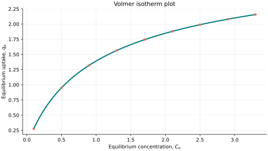
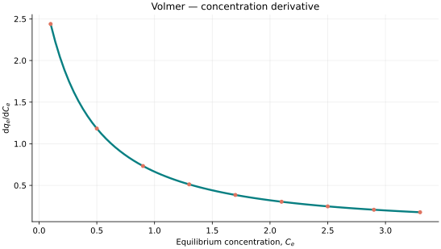
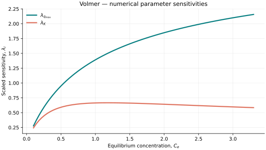

..
   ==============================================================================
   Name        : Volmer.rst
   Authors     : Joao Flavio Vasconcellos
   Version     : 2.0.0
   Description : Volmer scientific documentation and numerical parameter sensitivities.

   Copyright   : Copyright (C) 2026 Joao Flavio Vasconcellos
   Licence     : MIT License (see LICENSE)
   SPDX-License-Identifier: MIT
   ==============================================================================

Volmer isotherm
===============

Original publication and scope
------------------------------

Volmer, M. (1925), *Thermodynamische Folgerungen aus der Zustandsgleichung
für adsorbierte Stoffe*, *Zeitschrift für Physikalische Chemie*, **115U**
(1), 253–260. DOI: `10.1515/zpch-1925-11519
<https://doi.org/10.1515/zpch-1925-11519>`_. This is the principal
historical reference for the thermodynamic description of mobile adsorbed
films. The associated two-dimensional equation of state is conventionally
expressed as :math:`\pi(\Omega-\beta)=RT`, where :math:`\pi` is
spreading pressure, :math:`\Omega` is molar surface area and :math:`\beta`
represents an excluded-area term. These thermodynamic quantities should not
be confused with the two coefficients of the implemented isotherm.

Volmer, M., and Mahnert, P. (1925), *Über die Auflösung fester Körper in
Flüssigkeitsoberflächen und die Eigenschaften der dabei entstehenden
Schichten*, *Zeitschrift für Physikalische Chemie*, **115U** (1), 239–252.
DOI: `10.1515/zpch-1925-11518
<https://doi.org/10.1515/zpch-1925-11518>`_. This companion paper provides
historical context on surface films at liquid interfaces; it is not a
separate derivation of the concentration-based equation used below.

The present model uses an implicit relation between equilibrium
concentration and fractional surface coverage. Its specific adsorption
parametrisation is given in the next section; the thermodynamic surface-film
equation of state and the implemented concentration relation should not be
presented as identical equations.

Mathematical formulation
------------------------

.. math::

   K C_e=\frac{\theta}{1-\theta}\exp\left(\frac{\theta}{1-\theta}\right),\qquad q_e=q_{\max}\theta.

The admissible parameter and input domain is

.. math::

   q_{\max}>0,\quad K>0,\quad C_e\geq0,\quad 0\leq\theta<1.

.. math::

   \text{The implemented derivative requires }C_e>0.

Here :math:`C_e` denotes equilibrium concentration.

The adjustable parameters are :math:`q_{\max}`, :math:`K`.

C++20 usage
-----------

.. code-block:: cpp

   #include <isotherm/isotherm.hpp>

   const isotherm::models::Volmer model{4.5, 0.7};
   const isotherm::Real uptake = isotherm::evaluate(model, 0.5);   // 0.95048081
   const isotherm::Real slope = isotherm::derivative(model, 0.5);  // 1.1827348

.. raw:: html

   

     <a class="isotherm-source-action" href="../../../source-browser/include/isotherm/models/TwoParameters/Volmer.hpp.html">Implementation</a>
     <a class="isotherm-source-action" href="../../../source-browser/IsothermTest/TwoParameters/Volmer/test_volmer.cpp.html">Tests</a>
     <a class="isotherm-source-action" href="../../../source-browser/Examples/TwoParameters/Volmer/main.cpp.html">Example</a>
   

Volmer isotherm plot
--------------------

   Volmer uptake for :math:`q_{\max}=4.5`, :math:`K=0.7`.

Concentration derivative
------------------------

   Concentration derivative of Volmer uptake for :math:`q_{\max}=4.5`, :math:`K=0.7`.

Numerical sensitivity
---------------------

For each parameter :math:`k_i`, the scaled parameter sensitivity is

.. math::

   \lambda_i(x)=k_i\frac{\partial q_e(x)}{\partial k_i}.

Numerical values are obtained by perturbing individual parameters and evaluating new instances of the C++ model. The accompanying C++20 example performs this procedure.

   Scaled sensitivities :math:`\lambda_{q_{\max}}`, :math:`\lambda_{K}` versus equilibrium
   concentration.

Validation and limitations
--------------------------

.. math::

   q_{\max}>0,\quad K>0,\quad C_e\geq0,\quad 0\leq\theta<1.

.. math::

   \text{The implemented derivative requires }C_e>0.
